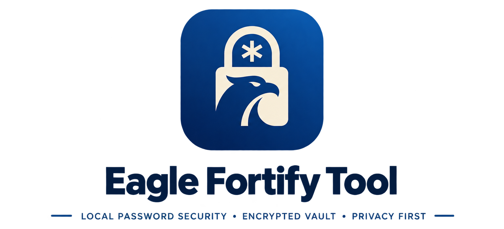
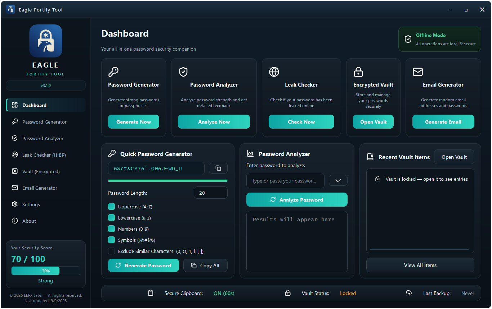
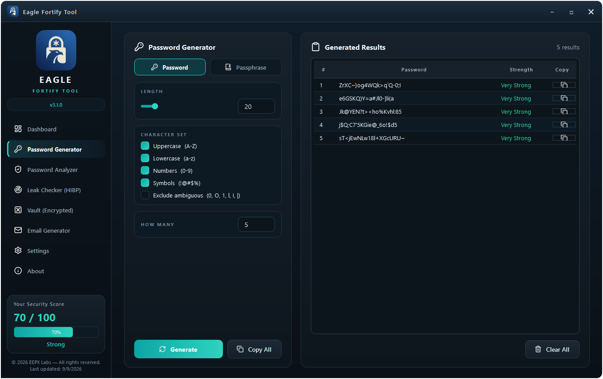
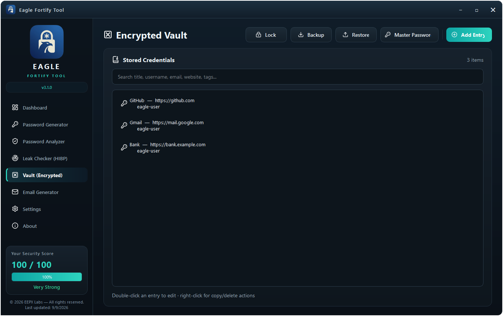
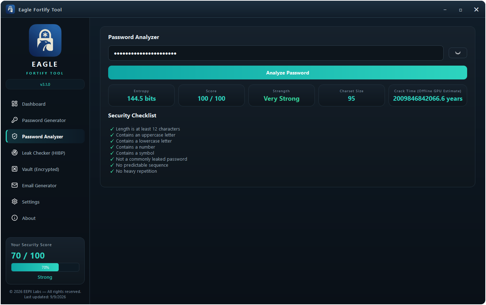
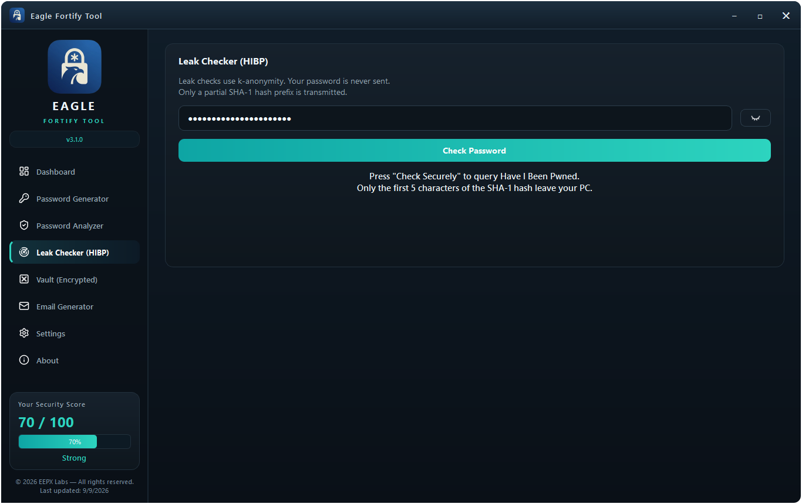
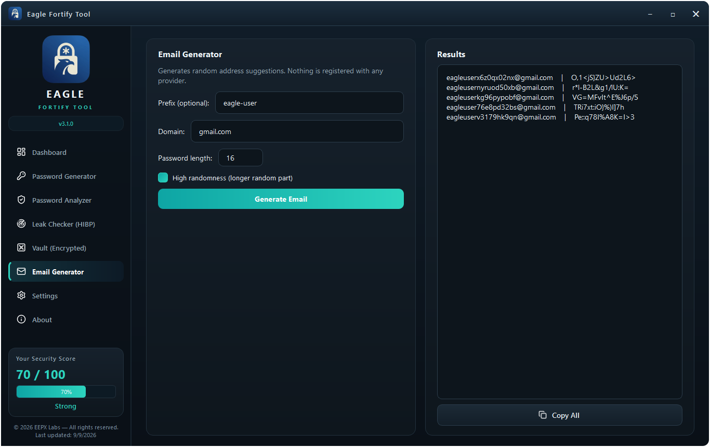

# Eagle Fortify Tool

<div align="center">



### Local Security · Encrypted Vault · Privacy First

A local password utility for generating strong passwords, analyzing password strength, creating passphrases and email identities, and storing credentials in an encrypted vault

[](https://www.python.org/)
[](https://doc.qt.io/qtforpython-6/)
[](https://csrc.nist.gov/)
[](https://www.microsoft.com/windows)
[](#using-the-command-line-tool)

[Features](#features) · [Installation](#install) · [Screenshots](#feature-tour) · [Security](#privacy--zero-knowledge-encryption) · [User Guide](docs/USER_GUIDE.md)

</div>

---

## Overview

Eagle Fortify Tool is a local password utility designed to help you create, analyze, and manage credentials without relying on a cloud account

It can generate strong passwords, evaluate password strength, create secure passphrases and email identities, check passwords against known data breaches, and store credentials in a private encrypted vault

Core features run locally on your device, and your vault data is not uploaded to a remote server

The optional breach-check feature requires an internet connection and uses the Have I Been Pwned k-anonymity model

## Features

- **Password Generator** — Generate strong passwords with configurable length and quantity
- **Password Analyzer** — Evaluate password strength and identify potential weaknesses
- **Passphrase Generator** — Create memorable passphrases using multiple words
- **Email Identity Generator** — Generate random email identities
- **Encrypted Vault** — Store credentials in an encrypted local vault
- **Breach Checker** — Check whether a password appears in known data breaches using a hash-prefix lookup
- **Desktop Application** — Access the tools through a graphical interface
- **Command-Line Interface** — Run supported operations directly from Command Prompt
- **Offline-First Design** — Use core password utilities without an internet connection
- **Encrypted Backups** — Keep encrypted copies of your vault for safekeeping

## Feature Tour

For the complete walkthrough, including screenshots and explanations, see the [Visual User Guide](docs/USER_GUIDE.md)

| Dashboard | Password Generator | Encrypted Vault |
|:---:|:---:|:---:|
|  |  |  |

| Password Analyzer | Leak Checker | Email Generator |
|:---:|:---:|:---:|
|  |  |  |

---

## Install

### Windows Installer (Recommended)

1. Download `EagleFortifyTool-3.2.0-Setup.exe` from the project's release files
2. Run the installer
3. Follow the installation instructions
4. Keep **Add eftool to PATH** enabled if you want to use the command-line tool from any Command Prompt
5. Open a new Command Prompt window after installation

Verify the installation

```bat
eftool --version
```

Expected output

```text
Eagle Fortify Tool 3.2.0
```

You can launch the desktop application from the Start Menu or desktop shortcut


Then run

```bat
eftool --version
```

### Troubleshooting: `eftool` Is Not Recognized

If Windows reports that `eftool` is not recognized

1. Close the current Command Prompt and open a new one
2. Confirm that the application is installed

   ```bat
   dir "C:\Program Files\Eagle Fortify Tool\eftool.exe"
   ```

3. Check whether the installation directory is included in your `PATH`

   ```bat
   echo %PATH%
   ```

4. If the directory is missing, rerun the installer and enable **Add eftool to PATH**
5. If an older development executable is taking precedence, check your `PATH` for outdated `eftool.exe` files and remove obsolete entries where appropriate

The installer is intended to configure `PATH` automatically, but existing terminal windows may need to be reopened before the updated environment takes effect

---

## Using the Command-Line Tool

The command-line interface is available through `eftool`

### Check the Version

```bat
eftool --version
```

### Generate Passwords

```bat
eftool generate
```

Generate three passwords, each 24 characters long

```bat
eftool generate --length 24 --count 3
```

### Analyze Password Strength

```bat
eftool analyze "your-password-here"
```

Avoid entering a real password directly into commands if your shell history or other local tools may retain command history

### Generate Passphrases

```bat
eftool passphrase
```

Generate a passphrase containing five words

```bat
eftool passphrase --words 5
```

### Generate Email Identities

```bat
eftool email
```

### Manage the Encrypted Vault

Create a vault

```bat
eftool vault create
```

List stored vault entries

```bat
eftool vault list
```

### Open the Desktop Application

Launch the graphical interface from Command Prompt

```bat
eagle-fortify-gui
```

Alternatively, open `EagleFortifyTool.exe` in the portable installation or use the installed Start Menu or desktop shortcut

### Command-Line Notes

- Core commands work offline
- The optional `eftool leak-check` command requires an internet connection
- The breach checker uses a hash-prefix lookup rather than sending the original password to the breach-check service
- Available commands and options may vary by release, so use `eftool --help` for the supported syntax

---

## Privacy & Zero-Knowledge Encryption

Eagle Fortify Tool is designed around local control and encrypted credential storage

### Local-First Architecture

The vault, password generator, passphrase generator, email identity generator, and password analyzer operate locally

The application does not require cloud synchronization or a remote account to use its core features

### Encrypted Vault

Vault entries are encrypted using **AES-256-GCM**

The encryption key is derived from the Master Password using **PBKDF2-HMAC-SHA256**, with 600,000 iterations and a random 32-byte salt

### Optional Breach Checking

The optional breach-check operation requires network access

It uses the Have I Been Pwned k-anonymity model, which sends only the first five characters of a SHA-1 password hash to the service for matching

The original password is not sent as part of that lookup

SHA-1 is used for compatibility with the breach-check protocol, not as the vault encryption algorithm

Whenever possible, check only passwords you no longer use

### Master Password & Recovery

Your Master Password is not stored as a recoverable password by the application

If it is lost, the encrypted vault may become permanently inaccessible

Keep your Master Password safe, as the developer cannot recover vault contents without the required secret

### Backups & Local Storage

Default data locations

| Data | Location |
|---|---|
| Encrypted vault | `%USERPROFILE%\.eagle_fortify\main.efv` |
| Application settings | `%USERPROFILE%\.eagle_fortify\settings.json` |

Vault backups are encrypted files as well

Store them somewhere secure and make sure you can access your Master Password when you need to restore them

Uninstalling the application does not automatically delete your vault

---

## Uninstall

### Installer Version

1. Open **Windows Settings → Apps**
2. Find **Eagle Fortify Tool**
3. Select **Uninstall**

If the installer configured the command-line tool in `PATH`, it is intended to remove that entry during uninstallation

### Portable Version

Delete the folder where you extracted the portable archive

If you manually added that folder to `PATH`, remove the corresponding environment-variable entry as well

Uninstalling or deleting the application folder does not necessarily remove your vault or settings

---

## Documentation

- [Visual User Guide](docs/USER_GUIDE.md) — Screenshots and explanations of the application's features
- [Changelog](CHANGELOG.md) — Release history and changes
- [License](LICENSE) — Terms and conditions governing use

---

## Technology

| Component | Technology |
|---|---|
| Programming Language | Python 3.14 |
| Desktop Interface | PySide6 / Qt for Python |
| Vault Encryption | AES-256-GCM |
| Key Derivation | PBKDF2-HMAC-SHA256 |
| Supported Platform | Windows |
| User Interfaces | Desktop GUI and CLI |

---

## EEPX Labs

Eagle Fortify Tool is developed under **EEPX Labs**

The project focuses on practical password utilities, local data control, and privacy-conscious credential management

---

## License

**Proprietary — All rights reserved**

See [LICENSE](LICENSE) for the full terms and conditions of use

<div align="center">

**Eagle Fortify Tool**

*Your credentials · Your device · Your control*

</div>
